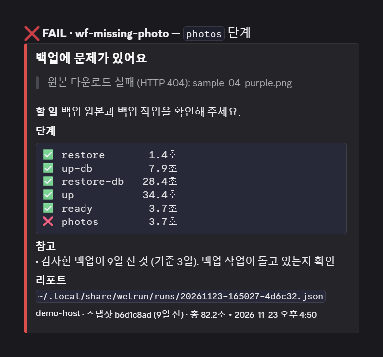
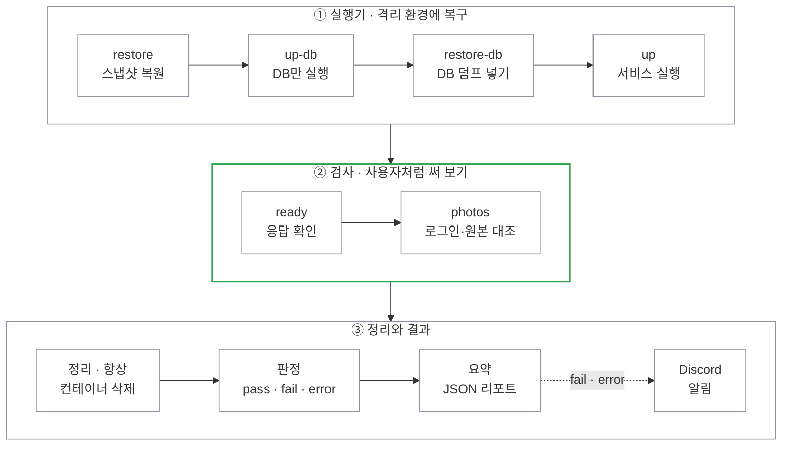

# Wetrun

[](https://github.com/wetrun/2026-OSS-TeamH-Wetrun/actions/workflows/ci.yml)
[](LICENSE)

**백업을 실제로 복구해 사용자처럼 써 보고, 서비스를 되살릴 수 있는지 판정하는 CLI.**

restic 백업으로 Docker Compose 서비스를 운영과 끊긴 격리 환경에 복구한 뒤, 로그인·목록 조회·원본 다운로드까지 해 본다.
결과는 `pass`·`fail`·`error`로 나누어 터미널 요약, JSON 리포트, Discord 알림으로 알린다. 첫 대상 서비스는 [Immich](https://immich.app)(사진 관리)다.

<p align="center">
  
</p>
<p align="center"><sub>사진 원본 1장을 지운 백업을 검사한 Discord 알림. 서버 응답 확인(ready)은 통과했고, 원본을 내려받는 photos 단계에서 잡았다.</sub></p>

## 왜 필요한가

백업 명령이 성공했다는 것과 그 백업으로 서비스를 되살릴 수 있다는 것은 다르다. DB 덤프가 깨졌거나 사진 원본 일부가 빠진 백업도 백업 작업은 정상으로 끝나고,
복구한 서버도 응답은 한다. 실제로 사진 원본이 빠진 백업은 서버 응답 확인을 통과했고, 원본을 내려받아 보고서야 잡혔다 ([설계 결정 11절](docs/design-decisions.md#11-v01-목표-확인-30-측정)).
그래서 Wetrun은 백업을 정기적으로 실제 복구해 보고, 사용자가 하는 동작으로 확인한다.

## 특징

- **사용자처럼 검사한다.** 서버가 떴는지만 보지 않고 로그인 → 목록 → 원본 다운로드까지 해서 정답지와 비교한다.
- **백업 문제와 환경 문제를 나눈다.** 백업을 고쳐야 하면 `fail`, 설정·환경을 고쳐야 하면 `error`다. 검사 코드가 예외로 죽어도 `fail`(백업 고장)로 기록되지 않는다.
- **확인한 범위만 말한다.** 원본은 시간 안에서 무작위로 최대한 받고, "손상 없음" 대신 "파일 1000개 전부 확인" 또는 "504개를 무작위로 확인, 손상 파일은 0.6% 미만 (95% 신뢰도)"처럼 근거가 있는 문장만 쓴다.
- **특정 서비스에 묶이지 않는다.** 본체(`wetrun/`)에는 서비스 이름이 없고(CI가 검사), 서비스별 내용은 워크플로 YAML 하나에 적는다. Immich·Gitea·Nextcloud로 확인했다.
- **운영을 건드리지 않는다.** 검증용 서비스는 바깥과 끊긴 네트워크에 띄우고, 판정과 상관없이 끝나면 항상 치운다.

## 동작 흐름



Immich 워크플로([`profiles/immich/workflow.yaml`](profiles/immich/workflow.yaml))의 6단계다. 필수 단계가 통과하지 못하면 남은 단계는 건너뛰고 바로 정리한다.
알림은 워크플로에 설정했을 때만 보내고, 기본은 `fail`·`error`일 때다. 정리 실패는 설정과 상관없이 항상 알린다.

## 판정

| 판정 | 종료 코드 | 뜻 | 할 일 |
|---|---|---|---|
| `pass` | 0 | 백업으로 서비스를 되살릴 수 있다 | 없음 |
| `fail` | 1 | 백업이나 복구한 데이터에 문제가 있다 | 백업을 고친다 |
| `error` | 2 | 검사를 끝까지 못 했다 (백업 문제 아님) | 설정·환경을 고친다 |
| 정리 실패 | 3 | 검증용 자원이 남았다 (판정보다 우선) | 남은 자원을 지운다 |

## 무엇을 잡나

Immich로 정상 백업과 일부러 망가뜨린 백업을 직접 돌려 본 결과다.

| 백업 | 판정 | 잡은 단계 | 메시지 |
|---|---|---|---|
| 정상 | `pass` | - | 파일 5개 전부 확인, 모두 원본과 일치 |
| DB 덤프 손상 | `fail` | `restore-db` | 명령이 실패함 |
| DB 덤프 누락 | `fail` | `restore-db` | 입력 파일이 없음 |
| 사진 원본 1장 삭제 | `fail` | `photos` | 원본 다운로드 실패 (HTTP 404) |
| 사진 원본 1바이트 손상 | `fail` | `photos` | 다운로드한 원본이 다른 파일 1개 |
| restic 비밀번호 틀림 | `error` | `restore` | 비밀번호가 틀림 |

- Gitea(SQLite)와 Nextcloud(MariaDB)까지 합쳐 서비스 3개, 정상 백업 3개는 모두 `pass`, 고장 백업 11개는 모두 `fail`이었다 ([eval/services](eval/services/README.md)).
- 사진 3,000개(약 12GiB)도 photos 단계 평균 54초에 전부 받아 확인했다. 시간을 줄이면 표본 검사로 바뀌고, 표본이 모자라면 `error`가 된다 ([eval/scale](eval/scale/README.md)).
- 고장 백업 만드는 방법: [docs/handoff/test.md](docs/handoff/test.md)

## 빠른 시작

필요한 것: Linux(Windows는 WSL2 Ubuntu), Docker Compose v2, restic 0.18 이상, [uv](https://docs.astral.sh/uv/), make.
설치는 [온보딩 3절](docs/onboarding.md#3-개발-환경-준비)을 본다.

```sh
git clone https://github.com/wetrun/2026-OSS-TeamH-Wetrun.git
cd 2026-OSS-TeamH-Wetrun
make install
make env    # 시험용 Immich + 사진 + restic 백업 (testenv)

# testenv 전용 공개 시험값
export RESTIC_PASSWORD=resticpwd TESTENV_ADMIN_PASSWORD=testpwd
uv run wetrun check-input profiles/immich/workflow.yaml   # 입력만 검사
uv run wetrun run profiles/immich/workflow.yaml           # 복구·검사 (1~2분)
```

터미널에서는 단계마다 진행 상황이 나오고, 끝나면 결과와 리포트 위치가 나온다.

```
[1/6] restore      pass     6.9초  스냅샷 복원
...
[6/6] photos       pass     3.2초  파일 5개 전부 확인, 모두 원본과 일치
정리 완료 0.8초

Wetrun 결과: PASS (종료 코드 0)
실행 20261124-132041-dc60dd · 스냅샷 bff850f9 (1시간 안) · 104.4초
리포트: /home/me/.local/share/wetrun/runs/20261124-132041-dc60dd.json
```

- Windows는 저장소를 WSL 홈(`~/`)에 clone한다 (`/mnt/c` 아래 금지). macOS는 [docs/handoff/runner.md](docs/handoff/runner.md)의 `WETRUN_WORKDIR` 안내를 본다.
- 검증하는 동안 서비스 하나만큼의 메모리와, 복원할 백업 크기만큼의 디스크가 더 필요하다. 운영 서버가 빠듯하면 다른 컴퓨터에서 돌린다.
- JSON 리포트는 `~/.local/share/wetrun/runs/`에 쌓인다 (`WETRUN_REPORT_DIR`로 바꿀 수 있다).

## 내 서비스에 쓰기

1. **워크플로 작성**: Immich 프로필을 복사해 백업 저장소·스냅샷·compose·정답지 경로와 계정을 바꾼다. 다른 서비스 예시는 [eval/services](eval/services/README.md)에 있다.
2. **정답지 만들기**: 운영 서비스에서 원본의 SHA-1을 계산해 `refs.json`을 만든다. 백업 스크립트에서 `restic backup` 바로 앞에 두면 정답지를 따로 관리할 필요가 없다.
   ```sh
   uv run wetrun refs workflow.yaml --url http://localhost:2283
   ```
3. **알림 켜기**: 웹훅 주소는 비밀 값이라 `env:`로만 쓴다. `pass`를 켜면 소리 없이 온다.
   ```yaml
   notify:
     discord: env:WETRUN_DISCORD_WEBHOOK
     when: [fail, error]   # 기본값. 매번 받으려면 [pass, fail, error]
   ```
4. **매일 실행**: 아래 명령이 출력하는 한 줄을 `crontab -e`에 붙여 넣는다. 같은 워크플로는 동시에 하나만 돈다.
   ```sh
   uv run wetrun schedule workflow.yaml --at 03:30 \
     --env-file ~/.config/wetrun.env
   ```

자세한 방법과 자주 겪는 문제는 [사용 안내](docs/user-guide.md)에 있다.

## 한계

- 백업 도구는 restic만 지원한다.
- 원본 파일 표본 검사는 손상이 무작위로 흩어져 있다고 가정한다. 서비스에 기록된 체크섬은 항상 전부 비교한다.
- 예약 실행이 아예 돌지 않으면 아무 연락도 오지 않는다. 서버 밖에서 지켜보는 방법은 [사용 안내 6절](docs/user-guide.md#6-실패-알림-discord)에 있다.
- 전체 목록은 [사용 안내 9절](docs/user-guide.md#9-한계-v01).

## 문서

| 문서 | 내용 |
|---|---|
| [docs/user-guide.md](docs/user-guide.md) | 설치부터 결과 읽기, 예약 실행, 알림, 원격 저장소, 문제 해결 |
| [docs/contract.md](docs/contract.md) | 실행기와 검사의 약속: 워크플로 YAML, 판정 규칙, 종료 코드 |
| [docs/design-decisions.md](docs/design-decisions.md) | 왜 그렇게 만들었나, 측정 결과 |
| [docs/handoff/](docs/handoff/README.md) | 역할별 작업 기록 |
| [eval/scale](eval/scale/README.md), [eval/services](eval/services/README.md) | 데이터 크기별 시간, 다른 서비스 확인 |
| [testenv/](testenv/README.md) | 개발·평가용 Immich 환경 |
| [CONTRIBUTING.md](CONTRIBUTING.md), [docs/onboarding.md](docs/onboarding.md) | 기여 규칙, 개발 환경 |

### 저장소 구조

| 경로 | 내용 |
|---|---|
| `wetrun/` | 본체: 실행기, restic 어댑터, 내장 검사(`steps/`), 리포트·알림. 서비스 이름 없음 |
| `profiles/<서비스>/` | 서비스별 워크플로 YAML |
| `testenv/` | 개발·평가용 Immich (배포 대상 아님) |
| `tests/` | 단위·통합 테스트 |
| `eval/` | 평가 스크립트와 결과 |

## 팀

2026 동국대학교 공개SW프로젝트 Team H

| 이름 | 역할 | GitHub |
|---|---|---|
| 차은호 | 실행기 | [chaeunho1227](https://github.com/chaeunho1227) |
| 조정민 | 검사·출력 | [YoungB0](https://github.com/YoungB0) |
| 정순준 | 환경·성능·사용자 평가·문서 | [soonjun1212-DGU](https://github.com/soonjun1212-DGU) |
| 김영모 | 테스트·평가 | [rlazeroah](https://github.com/rlazeroah) |

## 라이선스

[Apache-2.0](LICENSE)
